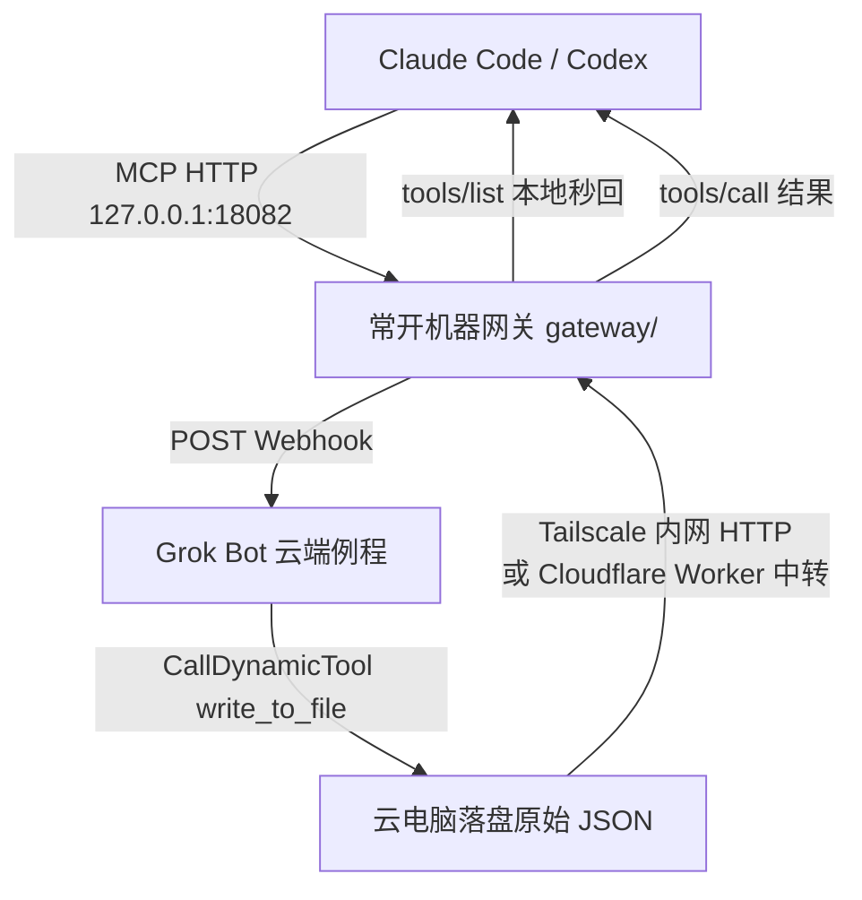

# grokbot-x-mcp-bridge

把 **Grok Bot 订阅自带的官方 X 接口**（公开读 `x` 命名空间 13 个工具 + 已授权账号侧 `user-X---` 约 83 个工具）桥成常开机器上的 **本地 MCP**，给 Claude Code / Codex / 其他 MCP 客户端直接拿 **原始 Tweet JSON**。

不是「让 Bot 搜完再写摘要」；是调用 Grok Bot 内部的官方工具面，原样落盘。

> 个人自用。不要把订阅内额度转售或公开共享。平台配额与例程策略可能变化。

## 原理

云电脑可能休眠：网关仍常驻；真正查数时 Webhook 会叫醒例程。若冷启动超过 MCP 客户端等待时间，网关会先返回 `error: waking`，**用相同参数重试**即可拿已在后台跑完的结果。

## 目录

| 路径 | 作用 |
| --- | --- |
| `cloud-box/` | 云电脑：Webhook 例程提示词、落盘脚本、`:18082` 取结果服务、守护 + Tailscale 自检 |
| `gateway/` | 常开机器：MCP 网关、工具目录、env 示例、自启动、Claude/Codex 接入示例 |
| `relay-cloudflare-worker/` | 可选：不用 Tailscale 时的结果中转 |
| `prompts/` | 两段一键部署提示词 + 验收清单 |

## 快速开始

1. 把 `prompts/01-deploy-cloud-box.md` 发给 **Grok Bot**，装云电脑端并创建 Webhook 例程。
2. 把 `prompts/02-deploy-gateway.md` 发给本机 Claude Code / Codex，装常开网关并接入 MCP。
3. 按 `prompts/03-acceptance.md` 验收。

默认端口：**18082**。公开读配额约 **30 次/分钟、1000 次/天（UTC）**（以 Grok Bot 返回的额度行为准）。

## 两种连通方式

1. **Tailscale（默认）**  
   **两边都要装** Tailscale，并登录**同一个** tailnet：云电脑可用 Grok Bot 的官方 Tailscale 插件一键接入，或在云电脑里安装 `tailscale` 后 `tailscale up` 登录；常开机器安装客户端（macOS / Windows / Linux：https://tailscale.com/download）登录同一账号。先 `tailscale ping <CLOUD_TS_IP>`，再 `curl http://<CLOUD_TS_IP>:18082/health`，互通通过后再配网关。云电脑 `http_server.py` 在 tailnet 内提供 `/response/<id>`；网关 `CLOUD_BOX_HTTP=http://<CLOUD_TS_IP>:18082`。
2. **Cloudflare Worker 中转（可选）**  
   不想装 Tailscale 时用。见 `relay-cloudflare-worker/`。网关与云电脑都配置 `RELAY_BASE_URL` + `RELAY_TOKEN`。

## 和「只让 Bot 去搜 X」的差别

| | 派任务给 Bot 写摘要 | 本仓库 |
| --- | --- | --- |
| 返回 | 链接 + 摘录/总结 | X API v2 风格原始 JSON |
| 字段 | 看提示词约法 | `public_metrics`、游标、`article`/`note_tweet` 等 |
| 账号侧 | 取决于你怎么写提示词 | `x_account_call` 按需调书签/时间线等 |
| MCP 形态 | 常见是「问 Bot」 | 13+1 工具列表，可直接 tools/call |

## 风险

- 依赖 Grok Bot 订阅内能力与 Webhook 例程；不是 X 开发者后台里那份独立付费 API 合约。
- 个人自用，勿转售额度或公开代理。
- Cookie/非官方抓取不在本方案范围内；本方案走 Grok Bot 已暴露的官方工具面。
